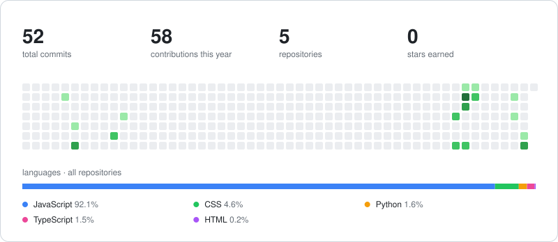

<h1 align="center">Hi, I'm Surya Gautam </h1> 
 Software Developer &nbsp;·&nbsp; Lalitpur, Nepal &nbsp; 
 
  
 
 
<b>Repositories</b> (public + private)
   <!--REPOS:START-->
**Public** 
`gsurya03`

**Private** 🔒 
`jane_doe` · `Dissension` · `log_X` · `Macallan` · `happy_new_year-2026-`
<!--REPOS:END--> 
 
<a href="https://www.instagram.com/lucid_onion/">  
